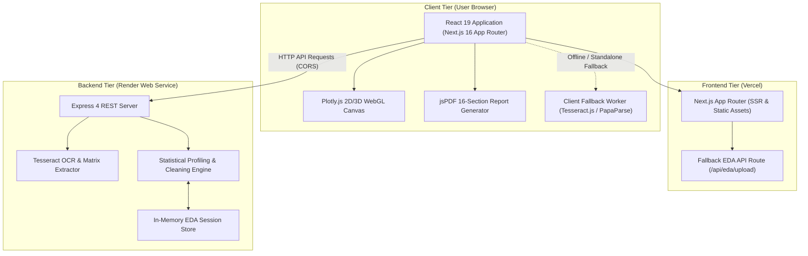
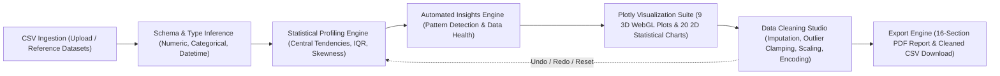

# 🧮 MathOML — Mathematical & Machine Learning Studio

[](https://nextjs.org/)
[](https://react.dev/)
[](https://www.typescriptlang.org/)
[](https://expressjs.com/)
[](https://plotly.com/javascript/)
[](LICENSE)

**MathOML** is an interactive mathematical computing, machine learning simulation, and automated exploratory data analysis studio. Crafted with **Next.js 16**, **React 19**, **TypeScript**, and **Express**, the platform combines an Apple & Notion-inspired luxury user interface with a full Computer Algebra System (CAS), interactive 2D/3D loss surface optimizers, intelligent mathematical and matrix OCR, and an **Automated EDA Studio** featuring WebGL visualizations, statistical inference, interactive cleaning pipelines, and PDF reporting.

---

## 📑 Table of Contents

- [System Architecture](#-system-architecture)
- [Automated EDA Pipeline](#-automated-eda-pipeline)
- [Design & User Interface Architecture](#-design--user-interface-architecture)
- [Core Workspaces & Capabilities](#-core-workspaces--capabilities)
  - [1. Automated Exploratory Data Analysis (EDA) Studio](#1-automated-exploratory-data-analysis-eda-studio)
  - [2. Machine Learning Arena & Reinforcement Learning](#2-machine-learning-arena--reinforcement-learning)
  - [3. Photometric Math OCR & Matrix Solver](#3-photometric-math-ocr--matrix-solver)
  - [4. Computer Algebra System (CAS)](#4-computer-algebra-system-cas)
- [Repository Structure](#-repository-structure)
- [REST API Reference](#-rest-api-reference)
- [Getting Started](#-getting-started)
  - [Prerequisites](#prerequisites)
  - [Installation & Local Setup](#installation--local-setup)
  - [Monorepo Command Reference](#monorepo-command-reference)
- [Technology Stack](#-technology-stack)
- [License](#-license)

---

## 🏛️ System Architecture

MathOML uses a decoupled two-tier monorepo architecture designed for independent continuous deployment:



---

## 🔄 Automated EDA Pipeline

The Automated EDA Studio ingests tabular CSV data, infers schemas, computes descriptive statistics, renders interactive 2D and 3D visual representations, applies data transformations with history tracking, and exports analysis reports:



---

## 🎨 Design & User Interface Architecture

The MathOML interface merges **Apple hardware design restraint** and **Notion workspace minimalism**:

- **Default Clean Canvas**: Launches with the sidebar collapsed, providing a distraction-free full-width canvas. The workspace navigation sidebar can be opened on demand via the header toggle or keyboard shortcut (`⌘\` / `Ctrl+\`).
- **Luxury Typography**: Features `Plus Jakarta Sans` for geometric precision, `Instrument Serif` for editorial brand elegance, and `JetBrains Mono` for mathematical accuracy.
- **Frosted Glass & Claymorphism**: Multi-stop radial atmospheric backdrops with frosted glass refraction (`backdrop-blur-2xl`), subtle inner bevels, and tactile clay surface cards.
- **Keynote Scroll Choreography**: Framer Motion scroll-linked transitions (`APPLE_EASE = [0.22, 1, 0.36, 1]`) fluidly glide elements between the hero stage, tactile metric ribbons, and bento workspace cards.

---

## ✨ Core Workspaces & Capabilities

### 1. Automated Exploratory Data Analysis (EDA) Studio

The Automated EDA Studio provides end-to-end dataset profiling, statistical evaluation, 2D/3D visualizations, data cleaning, and automated reporting.

#### A. CSV Ingestion & Automated Schema Understanding
- Supports file uploads up to **50 MB** as well as built-in reference datasets (Titanic, California Housing, Cardiovascular Health).
- Automatic detection of delimiter, character encoding, and header alignment.
- Automatic column type categorization:
  - **Numerical columns** (integer, float)
  - **Categorical columns** (nominal, ordinal)
  - **Datetime & Boolean columns**
- Immediate data health check: row count, column count, missing value count, and duplicate row detection.

#### B. Statistical Inference & Distribution Profiling
- **Descriptive Statistics**: Mean, median, mode, sample variance, standard deviation, and standard error.
- **Distribution Shape**: Interquartile range (IQR), skewness, and excess kurtosis.
- **Multivariate Correlation**: Pearson product-moment correlation matrix with interactive heatmap visualization.

#### C. Plotly.js 2D & 3D WebGL Visualizations
- **9 Three-Dimensional WebGL Visualizations**:
  - 3D Scatter with continuous color mapping
  - 3D Surface plots of bivariate kernel density estimates
  - 3D Mesh and Delaunay triangulations
  - 3D Loss landscape contours
  - 3D Bubble charts (4 dimensions: X, Y, Z, and marker radius)
- **20 Two-Dimensional Statistical Plots**:
  - Univariate histograms with KDE overlay curves
  - Box plots with jittered data points and outlier fences
  - Violin plots showing density estimation
  - Correlation heatmaps with configurable color scales
  - Cumulative empirical distribution functions (ECDF)

#### D. Interactive Data Cleaning Studio
- **Missing Value Imputation**: Mean, median, mode, constant value, or forward-fill.
- **Outlier Treatment**: IQR Tukey fences filtering, Z-score truncation, and percentile clipping.
- **Feature Scaling**: Standard normalization ($z = \frac{x - \mu}{\sigma}$), Min-Max normalization ($[0, 1]$), and Robust scaling.
- **Categorical Encoding**: One-hot encoding and ordinal label encoding.
- **Pipeline History**: Full undo, redo, and reset stack with state preservation.

#### E. 16-Section Executive PDF Report Generation
- Client-side report generation via `jsPDF` and `jsPDF-AutoTable`.
- Formatted tables with dataset health summaries, distribution metrics, outlier logs, and correlation matrices.

---

### 🧠 2. Machine Learning Arena & Reinforcement Learning

Interactive visual simulations of foundational machine learning algorithms:

- **Supervised Learning**:
  - **Linear Regression**: Ordinary Least Squares (OLS) closed-form calculation alongside iterative gradient descent updates.
  - **Logistic Regression**: Sigmoid activation function, dynamic decision boundary lines, and binary cross-entropy loss tracking.
  - **Support Vector Machines (SVM)**: Maximum-margin hyperplanes, support vector identification, and soft-margin slack ($\xi_i$).
- **Unsupervised Learning**:
  - **K-Means Clustering**: Step-by-step centroid updates with dynamic Voronoi cell partitioning.
  - **Principal Component Analysis (PCA)**: Covariance matrix eigenvalue decomposition and data projection along primary variance axes.
- **Reinforcement Learning**:
  - **Tabular Q-Learning**: Real-time agent training in a Gridworld environment displaying live Q-tables, $\epsilon$-greedy exploration curves, and cumulative reward tracking.

---

### 📷 3. Photometric Math OCR & Matrix Solver

- **Worksheet Question Segmentation**: Intelligently parses multi-part homework sheets and exams, segmenting questions by numbering formats (`1.`, `2.`, `Q1:`, `a)`, `(i)`).
- **Matrix Recognition**:
  - Detects 2D bracketed numbers and structured numerical grids.
  - Formats detected matrices into standard LaTeX (`\begin{pmatrix} ... \end{pmatrix}`).
  - Automatically routes recognized matrices directly into linear algebra solvers for determinants, inverses, eigenvalues, and rank.
- **Mathematical Formula Recognition**: Detects fractions, exponents, radicals, calculus notations, and Greek characters.
- **Dual Processing Architecture**: Runs client-side via Web Workers or offloads to the Express backend for server-side Tesseract execution.
- **Live KaTeX Typesetting**: Immediate mathematical rendering of recognized expressions alongside step-by-step analytical solutions.

---

### 🧮 4. Computer Algebra System (CAS)

Over 25 dedicated mathematical instruments:

- **Calculus**:
  - Derivatives of arbitrary order with step-by-step product, quotient, and chain rule breakdowns.
  - Definite and indefinite integrals with antiderivative verification.
  - Two-sided limits, continuity checks, and L'Hôpital's rule application.
  - Multivariable partial derivatives and Taylor / Maclaurin polynomial series expansions.
- **Linear Algebra**: Matrix multiplication, transposition, cofactor expansion determinants, Gauss-Jordan elimination for matrix inverses, and characteristic polynomial eigenvalue solvers.
- **Differential Equations (ODEs)**: Analytical solvers for separable, linear first-order, and second-order linear ODEs with constant coefficients; numerical integration via 4th-order Runge-Kutta (RK4).
- **Vector Calculus**: Gradient ($\nabla f$), divergence ($\nabla \cdot \mathbf{F}$), and curl ($\nabla \times \mathbf{F}$) across 2D and 3D scalar and vector fields.
- **Graphing Calculators**:
  - **2D Function Grapher**: Function curve plotting, tangent line computation, root finding, and definite integral shading.
  - **3D Surface Grapher**: Interactive surface plotting with Orbit camera controls, directional lighting, and wireframe options.

---

## 📁 Repository Structure

The project is structured as a two-folder monorepo:

```
mathlab-project/
├── backend/                      # Express & Node.js API Service
│   ├── src/
│   │   ├── eda-engine.ts         # Statistical profiler, data cleaning & CSV engine
│   │   ├── ocr.ts                # Tesseract OCR & matrix extraction pipeline
│   │   └── server.ts             # Express REST API routes, session manager & middleware
│   ├── package.json              # Backend dependencies (Express, Multer, Tesseract, PapaParse)
│   └── tsconfig.json             # TypeScript configuration for Node.js
│
├── frontend/                     # Next.js 16 Web Application
│   ├── src/
│   │   ├── app/                  # Next.js App Router (pages, layout, fallback API routes)
│   │   ├── components/
│   │   │   ├── tools/            # Math, ML, and EDA interactive instruments
│   │   │   │   ├── eda-tool.tsx              # Automated EDA Studio component
│   │   │   │   ├── PlotlyEDAChart.tsx        # 2D & 3D Plotly WebGL visualization suite
│   │   │   │   ├── EDACleanerPanel.tsx       # Messy data cleaning & transformation panel
│   │   │   │   ├── EDAPipelineSimulator.tsx  # 5-stage animated cleaning simulator
│   │   │   │   └── ...                       # 25+ CAS & Machine Learning tools
│   │   │   └── ui/               # Accessible UI components & clay/glass primitives
│   │   └── lib/
│   │       ├── math/             # CAS solvers, statistics engines & PDF generator
│   │       │   ├── eda-engine.ts # Client-side statistical calculation & transforms
│   │       │   └── eda-pdf.ts    # 16-section executive PDF report generator
│   │       └── utils.ts          # Styling and general helper utilities
│   ├── package.json              # Frontend dependencies (React 19, Plotly, jsPDF, KaTeX)
│   └── next.config.ts            # Next.js build and Webpack configuration
│
├── package.json                  # Root monorepo workspace scripts
└── README.md                     # Project documentation
```

---

## 🔌 REST API Reference

The backend Express service exposes the following endpoints:

| Method | Endpoint | Description | Payload / Parameters |
|---|---|---|---|
| `GET` | `/health` | Service health check and uptime monitor | None |
| `POST` | `/api/ocr` | Mathematical formula & matrix OCR extraction | `{ "image": "data:image/...;base64,..." }` |
| `POST` | `/api/eda/upload` | Multipart CSV upload, validation & initial profiling | `multipart/form-data` with field `file` |
| `POST` | `/api/eda/analyze` | Generates statistical profile & data insights | `{ "sessionId": "..." }` or `{ "csvText": "..." }` |
| `POST` | `/api/eda/transform` | Applies data cleaning transformation to active dataset | `{ "sessionId": "...", "action": "...", "column": "...", "params": {} }` |
| `GET` | `/api/eda/export/csv` | Streams cleaned dataset as downloadable CSV | Query parameter `?sessionId=...` |

---

## 🚀 Getting Started

### Prerequisites

- **Node.js**: v18.18.0 or newer (tested on Node v20 LTS & v22 LTS)
- **npm**: v9 or newer

### Installation & Local Setup

1. **Clone the repository**:
   ```bash
   git clone https://github.com/ayushshaury/MathOML-Lab.git
   cd mathlab-project
   ```

2. **Install all dependencies** across both frontend and backend:
   ```bash
   npm run install:all
   ```

3. **Start local development servers**:

   Start the Next.js frontend:
   ```bash
   npm run dev
   ```
   The application will be available at [http://localhost:3000](http://localhost:3000).

   In a separate terminal, start the Express backend:
   ```bash
   npm run backend:dev
   ```
   The API will be available at [http://localhost:10000](http://localhost:10000).

---

### Monorepo Command Reference

All root scripts coordinate both directories:

| Command | Action |
|---|---|
| `npm run dev` | Runs the Next.js frontend development server on port 3000 |
| `npm run build` | Compiles the production Next.js frontend bundle (`next build --webpack`) |
| `npm run start` | Runs the production Next.js frontend server on port 3000 |
| `npm run lint` | Runs ESLint across the frontend codebase |
| `npm run backend:dev` | Runs the Express backend server with hot-reload via `tsx watch` |
| `npm run backend:build` | Compiles backend TypeScript to production JavaScript (`dist/`) |
| `npm run backend:start` | Runs the compiled backend server (`node dist/server.js`) |
| `npm run install:all` | Executes `npm install` in both `frontend/` and `backend/` |

---

## 🧰 Technology Stack

| Domain | Technologies & Libraries |
|---|---|
| **Frontend Framework** | [Next.js 16](https://nextjs.org/) (App Router), [React 19](https://react.dev/), [TypeScript 5](https://www.typescriptlang.org/) |
| **Styling & Components** | [Tailwind CSS 4](https://tailwindcss.com/), [Radix UI](https://www.radix-ui.com/), [Lucide React](https://lucide.dev/), [Framer Motion](https://www.framer.com/motion/) |
| **Visualization & Charts** | [Plotly.js](https://plotly.com/javascript/) (WebGL 3D & 2D), [Recharts](https://recharts.org/), Canvas 2D |
| **Mathematical CAS** | [Math.js](https://mathjs.org/), [Nerdamer](https://nerdamer.com/), [KaTeX](https://katex.org/) |
| **Data & Statistical Profiling** | [PapaParse](https://www.papaparse.com/), Custom Statistical & Transformation Engines |
| **Reporting & Export** | [jsPDF](https://github.com/parallax/jsPDF), [jsPDF-AutoTable](https://github.com/simonbengtsson/jsPDF-AutoTable) |
| **Backend & OCR** | [Express 4](https://expressjs.com/), [Multer](https://github.com/expressjs/multer), [Tesseract.js](https://tesseract.projectnaptha.com/), [CORS](https://github.com/expressjs/cors) |
| **Deployment Targets** | [Vercel](https://vercel.com) (Frontend), [Render](https://render.com) (Backend Web Service) |

---

## 📄 License

This project is licensed under the [MIT License](LICENSE).
