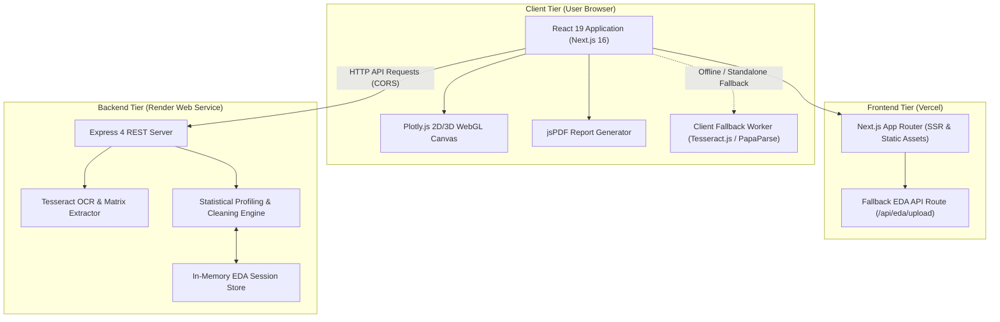
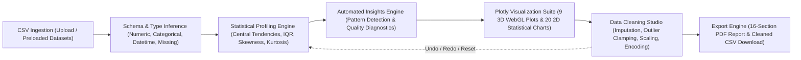

# 🧮 MathOML — Mathematical & Machine Learning Studio

[](https://nextjs.org/)
[](https://react.dev/)
[](https://www.typescriptlang.org/)
[](https://expressjs.com/)
[](https://plotly.com/javascript/)
[](LICENSE)

MathOML is an interactive mathematical computing, machine learning simulation, and automated exploratory data analysis studio. Built with **Next.js 16**, **React 19**, **TypeScript**, and **Express**, the platform provides a complete Computer Algebra System (CAS), interactive 2D and 3D loss surface optimizers, intelligent mathematical and matrix OCR, and an **Automated EDA Studio** with WebGL visualizations, statistical inference, data cleaning pipelines, and PDF reporting.

---

## 📑 Table of Contents

- [System Architecture](#-system-architecture)
- [Automated EDA Pipeline](#-automated-eda-pipeline)
- [Core Modules & Capabilities](#-core-modules--capabilities)
  - [1. Automated Exploratory Data Analysis (EDA) Studio](#1-automated-exploratory-data-analysis-eda-studio)
  - [2. Machine Learning Arena](#2-machine-learning-arena)
  - [3. Intelligent Math OCR & Matrix Solver](#3-intelligent-math-ocr--matrix-solver)
  - [4. Computer Algebra System (CAS)](#4-computer-algebra-system-cas)
- [Repository Structure](#-repository-structure)
- [REST API Reference](#-rest-api-reference)
- [Getting Started](#-getting-started)
  - [Prerequisites](#prerequisites)
  - [Installation & Local Setup](#installation--local-setup)
  - [Monorepo Command Reference](#monorepo-command-reference)
- [Technology Stack](#-technology-stack)
- [License](#-license)

---

## 🏛️ System Architecture

MathOML uses a decoupled two-tier monorepo architecture designed for independent continuous deployment:



---

## 🔄 Automated EDA Pipeline

The Automated EDA Studio ingests tabular CSV data, infers schemas, computes descriptive statistics, renders interactive 2D and 3D visual representations, applies data transformations with history tracking, and exports analysis reports:



---

## ✨ Core Modules & Capabilities

### 1. Automated Exploratory Data Analysis (EDA) Studio

The Automated EDA Studio provides end-to-end dataset profiling, statistical evaluation, 2D/3D visualizations, data cleaning, and automated reporting.

#### A. CSV Ingestion & Automated Schema Understanding
- Supports file uploads up to **50 MB** as well as built-in reference datasets (Titanic, California Housing, Cardiovascular Health).
- Automatic detection of delimiter, character encoding, and header alignment.
- Automatic column type categorization:
  - **Numerical columns** (integer, float)
  - **Categorical columns** (nominal, ordinal)
  - **Boolean columns**
  - **Datetime columns** (ISO-8601, standard date formats)
  - **Potential ID columns** (high cardinality sequential identifiers)
  - **Constant columns** (zero-variance features)
- Comprehensive dimension profiling: total rows, columns, cell count, missing cells, completeness percentage, and memory footprint.

#### B. Statistical Profiling & Data-Driven Insights
- **Measures of Central Tendency**: Mean, median, and mode.
- **Measures of Dispersion**: Variance, standard deviation, minimum, maximum, range, and Interquartile Range ($Q_1, Q_3, \text{IQR}$).
- **Distribution Characteristics**: Pearson-Fisher skewness coefficient and excess kurtosis.
- **Automated Evidence-Based Insights**:
  - Skewness diagnosis with recommended transformations ($\log$, $\sqrt{x}$, Box-Cox).
  - Outlier detection via Tukey's fences ($1.5 \times \text{IQR}$) and $Z$-score thresholds ($|z| > 3$).
  - Pairwise Pearson and Spearman correlation analysis with alerts for collinearity ($|r| \ge 0.7$).
  - Categorical class imbalance detection and cardinality warnings.
  - Missing-data patterns and data-quality risk scores.

#### C. Interactive 2D & 3D Plotly Visualizations
MathOML provides 29 Plotly visualization modes with dynamic axes selection, custom color palettes, camera orbit controls, and export options:

| Category | Chart Type | Description & Mathematical Focus |
|---|---|---|
| **3D WebGL** | **3D Scatter Plot** | 3-axis continuous variable distribution with continuous color mapping |
| **3D WebGL** | **3D Bubble Plot** | 4-variable visualization mapping point radius to a 4th metric |
| **3D WebGL** | **3D Line Plot** | Trajectory and sequential state tracing across 3 continuous axes |
| **3D WebGL** | **3D Surface Plot** | Bivariate continuous surface mesh $z = f(x, y)$ with custom colormaps |
| **3D WebGL** | **3D Mesh Plot** | Triangulated point cloud geometry for irregular spatial clusters |
| **3D WebGL** | **3D Volume Plot** | Volumetric intensity rendering for continuous 3D field distributions |
| **3D WebGL** | **3D Isosurface Plot** | Isosurface shell contours for scalar volumetric data |
| **3D WebGL** | **3D Cone Plot** | 3D vector field directional orientation and magnitude flow |
| **3D WebGL** | **3D Streamtube Plot** | Fluid and gradient streamlines tracing directional trajectories |
| **2D Distribution** | **Histogram** | Dynamic bin widths with normal distribution and density overlays |
| **2D Distribution** | **Box Plot** | Median, quartiles, Tukey fences ($1.5\text{IQR}$), and individual outlier points |
| **2D Distribution** | **Violin Plot** | Mirrored Gaussian kernel density envelope combined with box plot markers |
| **2D Distribution** | **KDE Plot** | Real-time Gaussian Kernel Density Estimation with bandwidth adjustment |
| **2D Relationships** | **Scatter & Regression** | 2D scatter with Ordinary Least Squares (OLS) trendline and residual errors |
| **2D Relationships** | **Bubble Chart** | 2D multi-dimensional comparison with dynamic bubble radius scaling |
| **2D Relationships** | **Pair Plot Matrix** | Multi-variable scatter matrix with diagonal univariate distributions |
| **2D Categorical** | **Bar Chart** | Categorical frequency counts with sorting and percentage labels |
| **2D Categorical** | **Pie & Donut Charts** | Proportional composition breakdowns with hover tooltips |
| **2D Diagnostics** | **Correlation Heatmap** | Pearson correlation matrix with interactive color scale and coefficients |
| **2D Diagnostics** | **Q-Q Normality Plot** | Empirical quantiles plotted against theoretical normal distribution quantiles |
| **2D Diagnostics** | **Missingness Matrix** | Null/NaN distribution pattern across rows and columns |
| **2D Hierarchical** | **Treemap & Sunburst** | Nested categorical composition with drill-down exploration |
| **2D Multivariate** | **Parallel Coordinates** | High-dimensional feature comparison across continuous axes |
| **2D Density** | **2D Contour Plot** | Bivariate density contours identifying local distribution peaks |

#### D. Messy Data Cleaning Studio
- **Missing Value Handling**:
  - Complete case analysis (drop rows with missing values).
  - High-missingness feature removal (drop columns above a user-defined missing threshold).
  - Imputation via central tendencies: **Mean**, **Median**, or **Mode**.
  - Constant value substitution.
- **Outlier Mitigation**:
  - Tukey's IQR Winsorization (clamping points outside $[Q_1 - 1.5\text{IQR}, Q_3 + 1.5\text{IQR}]$).
  - $Z$-Score truncation ($|z| > 3$).
  - Row-level outlier deletion.
- **Feature Scaling & Transformations**:
  - Standardization ($Z$-Score: $\mu = 0, \sigma = 1$).
  - Min-Max Normalization (rescaling to $[0, 1]$).
  - Robust Scaler (median-centered, IQR-scaled).
  - MaxAbs Scaler (rescaling by absolute maximum).
  - Logarithmic Transformation ($\ln(1 + x)$) for right-skewed variables.
- **Encoding & Casting**:
  - One-Hot Encoding for low-cardinality nominal features.
  - Label Encoding for ordinal features.
  - Column type casting (e.g., categorical to numerical, string to datetime).
- **Undo / Redo / Reset History Stack**: Every cleaning action is appended to an immutable history stack allowing instant rollback or reset.

#### E. 5-Stage Animated Data Cleaning Pipeline Simulator
Interactive SVG animation demonstrating the step-by-step transformation of raw, messy data into standardized features:
1. **Stage 1 (Scan & Flag)**: Highlights missing entries, data type mismatches, and anomalies.
2. **Stage 2 (IQR Caliper Measurement)**: Visual calipers expand from the median to $Q_1$, $Q_3$, and Tukey fences.
3. **Stage 3 (Imputation)**: Missing observations transition smoothly to the feature mean or median.
4. **Stage 4 (Winsorization & Clamping)**: Outliers beyond the fences glide along the distribution axis to boundary values.
5. **Stage 5 (Normalization)**: The entire feature distribution contracts into standard $[0, 1]$ or $Z$-score unit bounds.

#### F. Reporting & Data Export
- **16-Section PDF Executive Analysis Report**: In-browser PDF generation via `jsPDF` and `jspdf-autotable`, including:
  - Dataset overview and dimensional summary.
  - Column schema and type distribution.
  - Full parametric and non-parametric statistical tables.
  - Correlation matrices and collinearity warnings.
  - Missing value patterns and outlier logs.
  - Embedded high-resolution Plotly chart snapshot.
  - Transformation audit trail documenting every cleaning operation applied.
- **Cleaned CSV Export**: Direct client-side or backend download of the transformed dataset.

---

### 🧠 2. Machine Learning Arena

Interactive machine learning laboratories combining mathematical derivations, parameter controls, real-time visual feedback, and from-scratch Python implementations:

- **Optimization Studio**:
  - **Gradient Descent (GD) & Stochastic Gradient Descent (SGD)**: Step-by-step parameter trajectory updates.
  - **3D Loss Landscapes & 2D Contour Maps**: Real-time rendering of multimodal surfaces (Rosenbrock, Ackley, Saddle points, Sphere, Beale).
  - **Optimizer Comparisons**: Visual convergence paths comparing Vanilla Gradient Descent, Momentum, and Adam ($\beta_1, \beta_2, \epsilon$).
  - **Hyperparameter Tuning**: Real-time controls for learning rate ($\alpha$), momentum coefficient, batch size, and epoch limits.
- **Supervised Learning**:
  - **Linear Regression**: Ordinary Least Squares (OLS) closed-form calculation alongside iterative gradient updates.
  - **Logistic Regression**: Sigmoid activation function, dynamic decision boundary lines, and binary cross-entropy loss tracking.
  - **Support Vector Machines (SVM)**: Maximum-margin hyperplanes, support vector identification, and soft-margin slack ($\xi_i$).
- **Unsupervised Learning & Reinforcement Learning**:
  - **K-Means Clustering**: Step-by-step centroid updates with dynamic Voronoi cell partitioning.
  - **Principal Component Analysis (PCA)**: Covariance matrix eigenvalue decomposition and data projection along primary variance axes.
  - **Tabular Q-Learning**: Real-time agent training in a Gridworld environment displaying live Q-tables, $\epsilon$-greedy exploration curves, and cumulative reward tracking.

---

### 📷 3. Intelligent Math OCR & Matrix Solver

- **Worksheet Question Segmentation**: Intelligently parses multi-part homework sheets and exams, segmenting questions by numbering formats (`1.`, `2.`, `Q1:`, `a)`, `(i)`).
- **Matrix Recognition**:
  - Detects 2D bracketed numbers and structured numerical grids.
  - Formats detected matrices into standard LaTeX (`\begin{pmatrix} ... \end{pmatrix}`).
  - Automatically routes recognized matrices directly into linear algebra solvers for determinants, inverses, eigenvalues, and rank.
- **Mathematical Formula Recognition**: Detects fractions, exponents, radicals, calculus notations, and Greek characters.
- **Dual Processing Architecture**: Runs client-side via Web Workers or offloads to the Express backend for server-side Tesseract execution.
- **Live KaTeX Typesetting**: Immediate mathematical rendering of recognized expressions alongside step-by-step analytical solutions.

---

### 🧮 4. Computer Algebra System (CAS)

Over 25 dedicated mathematical instruments:

- **Calculus**:
  - Derivatives of arbitrary order with step-by-step product, quotient, and chain rule breakdowns.
  - Definite and indefinite integrals with antiderivative verification.
  - Two-sided limits, continuity checks, and L'Hôpital's rule application.
  - Multivariable partial derivatives and Taylor / Maclaurin polynomial series expansions.
- **Linear Algebra**: Matrix multiplication, transposition, cofactor expansion determinants, Gauss-Jordan elimination for matrix inverses, and characteristic polynomial eigenvalue solvers.
- **Differential Equations (ODEs)**: Analytical solvers for separable, linear first-order, and second-order linear ODEs with constant coefficients; numerical integration via 4th-order Runge-Kutta (RK4).
- **Vector Calculus**: Gradient ($\nabla f$), divergence ($\nabla \cdot \mathbf{F}$), and curl ($\nabla \times \mathbf{F}$) across 2D and 3D scalar and vector fields.
- **Graphing Calculators**:
  - **2D Function Grapher**: Function curve plotting, tangent line computation, root finding, and definite integral shading.
  - **3D Surface Grapher**: Interactive surface plotting with Orbit camera controls, directional lighting, and wireframe options.

---

## 📁 Repository Structure

The project is structured as a two-folder monorepo:

```
mathlab-project/
├── backend/                      # Express & Node.js API Service (Deploy on Render)
│   ├── src/
│   │   ├── eda-engine.ts         # Statistical profiler, data cleaning & CSV engine
│   │   ├── ocr.ts                # Tesseract OCR & matrix extraction pipeline
│   │   └── server.ts             # Express REST API routes, session manager & middleware
│   ├── package.json              # Backend dependencies (Express, Multer, Tesseract, PapaParse)
│   └── tsconfig.json             # TypeScript configuration for Node.js
│
├── frontend/                     # Next.js 16 Web Application (Deploy on Vercel)
│   ├── src/
│   │   ├── app/                  # Next.js App Router (pages, layout, fallback API routes)
│   │   ├── components/
│   │   │   ├── tools/            # Math, ML, and EDA interactive instruments
│   │   │   │   ├── eda-tool.tsx              # Automated EDA Studio component
│   │   │   │   ├── PlotlyEDAChart.tsx        # 2D & 3D Plotly WebGL visualization suite
│   │   │   │   ├── EDACleanerPanel.tsx       # Messy data cleaning & transformation panel
│   │   │   │   ├── EDAPipelineSimulator.tsx  # 5-stage animated cleaning simulator
│   │   │   │   └── ...                       # 25+ CAS & Machine Learning tools
│   │   │   └── ui/               # Radix UI primitives and accessible UI components
│   │   └── lib/
│   │       ├── math/             # CAS solvers, statistics engines & PDF generator
│   │       │   ├── eda-engine.ts # Client-side statistical calculation & transforms
│   │       │   └── eda-pdf.ts    # 16-section executive PDF report generator
│   │       └── utils.ts          # Styling and general helper utilities
│   ├── package.json              # Frontend dependencies (React 19, Plotly, jsPDF, KaTeX)
│   └── next.config.ts            # Next.js build and Webpack configuration
│
├── render.yaml                   # Render Blueprint configuration for backend
├── package.json                  # Root monorepo workspace scripts
└── README.md                     # Project documentation
```

---

## 🔌 REST API Reference

The backend Express service exposes the following endpoints:

| Method | Endpoint | Description | Payload / Parameters |
|---|---|---|---|
| `GET` | `/health` | Service health check and uptime monitor | None |
| `POST` | `/api/ocr` | Mathematical formula & matrix OCR extraction | `{ "image": "data:image/...;base64,..." }` |
| `POST` | `/api/eda/upload` | Multipart CSV upload, validation & initial profiling | `multipart/form-data` with field `file` |
| `POST` | `/api/eda/analyze` | Generates statistical profile & data insights | `{ "sessionId": "..." }` or `{ "csvText": "..." }` |
| `POST` | `/api/eda/transform` | Applies data cleaning transformation to active dataset | `{ "sessionId": "...", "action": "...", "column": "...", "params": {} }` |
| `GET` | `/api/eda/export/csv` | Streams cleaned dataset as downloadable CSV | Query parameter `?sessionId=...` |

---

## 🚀 Getting Started

### Prerequisites

- **Node.js**: v18.18.0 or newer (tested on Node v20 LTS & v22 LTS)
- **npm**: v9 or newer

### Installation & Local Setup

1. **Clone the repository**:
   ```bash
   git clone https://github.com/ayushshaury/MathOML-Lab.git
   cd mathlab-project
   ```

2. **Install all dependencies** across both frontend and backend:
   ```bash
   npm run install:all
   ```

3. **Start local development servers**:

   Start the Next.js frontend:
   ```bash
   npm run dev
   ```
   The application will be available at [http://localhost:3000](http://localhost:3000).

   In a separate terminal, start the Express backend:
   ```bash
   npm run backend:dev
   ```
   The API will be available at [http://localhost:10000](http://localhost:10000).

---

### Monorepo Command Reference

All root scripts coordinate both directories:

| Command | Action |
|---|---|
| `npm run dev` | Runs the Next.js frontend development server on port 3000 |
| `npm run build` | Compiles the production Next.js frontend bundle (`next build --webpack`) |
| `npm run start` | Runs the production Next.js frontend server on port 3000 |
| `npm run lint` | Runs ESLint across the frontend codebase |
| `npm run backend:dev` | Runs the Express backend server with hot-reload via `tsx watch` |
| `npm run backend:build` | Compiles backend TypeScript to production JavaScript (`dist/`) |
| `npm run backend:start` | Runs the compiled backend server (`node dist/server.js`) |
| `npm run install:all` | Executes `npm install` in both `frontend/` and `backend/` |

---

## 🧰 Technology Stack

| Domain | Technologies & Libraries |
|---|---|
| **Frontend Framework** | [Next.js 16](https://nextjs.org/) (App Router), [React 19](https://react.dev/), [TypeScript 5](https://www.typescriptlang.org/) |
| **Styling & Components** | [Tailwind CSS 4](https://tailwindcss.com/), [Radix UI](https://www.radix-ui.com/), [Lucide React](https://lucide.dev/), [Framer Motion](https://www.framer.com/motion/) |
| **Visualization & Charts** | [Plotly.js](https://plotly.com/javascript/) (WebGL 3D & 2D), [Recharts](https://recharts.org/), Canvas 2D |
| **Mathematical CAS** | [Math.js](https://mathjs.org/), [Nerdamer](https://nerdamer.com/), [KaTeX](https://katex.org/) |
| **Data & Statistical Profiling** | [PapaParse](https://www.papaparse.com/), Custom Statistical & Transformation Engines |
| **Reporting & Export** | [jsPDF](https://github.com/parallax/jsPDF), [jsPDF-AutoTable](https://github.com/simonbengtsson/jsPDF-AutoTable) |
| **Backend & OCR** | [Express 4](https://expressjs.com/), [Multer](https://github.com/expressjs/multer), [Tesseract.js](https://tesseract.projectnaptha.com/), [CORS](https://github.com/expressjs/cors) |
| **Deployment Targets** | [Vercel](https://vercel.com) (Frontend), [Render](https://render.com) (Backend Web Service) |

---

## 📄 License

This project is licensed under the [MIT License](LICENSE).
